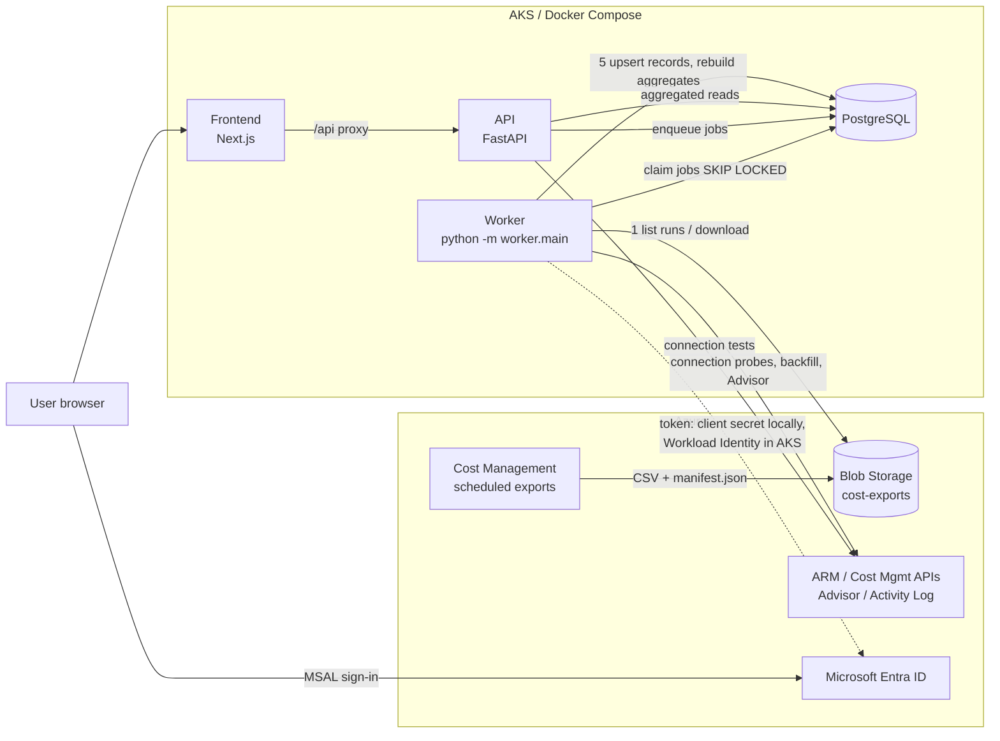

# Architecture

Azure Cost Intelligence Platform (ACIP) answers one question: *"cost went up compared with
last week — exactly which application, environment, subscription, service, resource group,
resource and billing meter caused it, and what changed?"*

## Components

| Component | Technology | Responsibility |
|---|---|---|
| **Frontend** (`frontend/`) | Next.js 15 (App Router), React 19, TypeScript, MUI 7, Apache ECharts 5.6, TanStack Table/Query, React Hook Form + Zod 4, MSAL | Enterprise UI (13 modules). Renders only aggregated API results. A runtime proxy (`app/api/[...path]/route.ts`) forwards `/api/*` to the backend using `BACKEND_INTERNAL_URL`, so one image works in every environment. |
| **API** (`backend/app/`) | Python 3.12, FastAPI, Pydantic 2, SQLAlchemy 2, psycopg 3 | Reporting, comparison, anomaly, budget, savings, ingestion-control and administration endpoints under `/api/v1`. All cost maths lives here (`app/analytics`, `app/anomaly_detection`, `app/forecasting`). Never calls Azure billing APIs on a dashboard request. |
| **Ingestion worker** (`backend/worker/`) | Same image as the API, `python -m worker.main` | Discovers Cost Management export runs, ingests them idempotently into PostgreSQL, rebuilds aggregates, runs anomaly detection, savings evaluation, budget alerts and notifications. |
| **PostgreSQL 16** | Azure Database for PostgreSQL Flexible Server in AKS; container locally | System of record: configuration, partitioned billing records, pre-aggregated reporting tables, job queue, analytics, audit. |
| **Azure Blob Storage** | Cost Management exports target | Daily ActualCost / AmortizedCost export files (CSV, v2 layout with `manifest.json`). |
| **Microsoft Entra ID** | Two identities | (1) the **existing collection service principal** used by the backend/worker for ARM, Cost Management and Blob access; (2) the **application user sign-in** (SPA + API app registrations). They are never mixed. |



### Data flow (export → dashboard)

1. Azure Cost Management writes scheduled export runs to Blob Storage
   (`<root>/<export>/<YYYYMMDD-YYYYMMDD>/<runId>/part_*.csv` + `manifest.json`).
2. The worker's scheduler enqueues a `sync_subscription` job per enabled subscription every
   `EXPORT_DISCOVERY_INTERVAL_MINUTES` (default 60) — Azure export times are not assumed.
3. The worker lists runs under each export definition, downloads files, computes SHA-256.
4. Rows are schema-mapped, validated, normalised (`NORMALIZER_VERSION`) and allocated
   (application / environment / service category / owner / cost center) while streaming
   into the UNLOGGED `cost_records_staging` table via `COPY`.
5. Completeness is validated (manifest row counts, rejection threshold).
6. In **one transaction**: the run's reporting period is replaced for that subscription and
   dataset (`cost_data_slices` prevents older runs overwriting newer data), the four
   aggregate tables are rebuilt for the affected days, the resource inventory is upserted.
7. An `analytics` job runs anomaly detection, savings evaluation, budget/forecast snapshots
   and notifications.
8. The API answers every chart from the pre-aggregated tables; the browser receives only the
   aggregated rows needed for the current view.

## Key decisions

| Decision | Rationale |
|---|---|
| **Modular monolith + separate worker process** | One deployable API with clear internal modules (analytics, anomaly detection, forecasting, integrations, services, repositories). No microservices without a measured need. Ingestion is isolated as its own process so heavy imports never affect API latency. |
| **Worker package lives in `backend/worker/` and ships in the backend image** | The worker shares the ORM models, allocation engine, aggregation SQL and anomaly engine with the API. One image means one dependency set, one vulnerability scan and no model drift between producer and consumer. The process boundary (different command / Deployment) still separates ingestion from reporting. |
| **PostgreSQL as the job queue (no Redis / Celery)** | `ingestion_jobs` rows are claimed with `UPDATE … WHERE id = (SELECT … FOR UPDATE SKIP LOCKED LIMIT 1)`. Durable, transactional with the data it changes, inspectable from SQL and the Data Management page, and any number of worker replicas can run. Scheduling uses a PostgreSQL advisory-lock leader (`pg_try_advisory_lock(778899)`). |
| **Exports as the primary source; APIs only for control** | Dashboards never hit Azure. The Cost Details API is an admin-triggered backfill path; the Cost Management query API is only used for a one-day permission probe in connection tests. |
| **Replace-by-slice, not append** | Export runs are cumulative month-to-date snapshots and revisions. Each run *replaces* its declared period per (subscription, dataset). Re-processing the same file or a revision is idempotent; identical-looking billing rows are never collapsed by row hashing. |
| **Periods anchored to the latest billing date** | Relative presets (today, week-to-date, last 30 days …) are resolved against the *as-of date* — the latest usage date with data in scope — because Azure data lags 8–72 h. Anchoring to the wall clock would make every current period look like a cost drop. The resolved dates are always shown. |
| **Pre-aggregated tables + table router** | `CostRepository.choose_table` picks the coarsest of `monthly → daily → resource → meter → raw` that contains every requested dimension, so dashboard queries stay predictable as raw data grows. |
| **One query result per explorer view** | `/costs/explorer` returns groups, time series and the reconciled waterfall together; all chart types and the table render from it, so switching chart type never refetches or resets filters. |
| **Decimal arithmetic, rounding only at serialisation** | All comparison/waterfall maths use `Decimal`; waterfalls report `reconciled` and the exact `reconciliation_difference`. |
| **Never mix currencies or cost types** | Every query is filtered to one dataset (`actual` / `amortized`) and one billing currency; other currencies in scope are reported as a warning, not summed. |
| **Read-only towards Azure** | No code path creates, stops, resizes or deletes Azure resources. Savings are estimates with stated assumptions. |

## Backend module map

```
backend/app/
  api/v1/            REST routers (meta, dashboard, costs, resources, anomalies, applications,
                     budgets, savings, notifications, ingestion, azure, admin)
  analytics/         periods.py (presets/comparison periods), comparison.py (formulas, waterfall),
                     decomposition.py (price/volume root cause), allocation.py (attribution engine)
  anomaly_detection/ rules.py (pure detectors, severity), engine.py (DB-bound runner, episodes, evidence)
  forecasting/       forecast.py (run_rate / recent / trend, budget status)
  repositories/      cost_repository.py (query builder + table router)
  services/          reporting, resources, budgets, savings, notifications, freshness, connections,
                     subscriptions, exports, jobs, settings, seed, audit
  integrations/      azure_auth (credential factory), azure_cost_management (ARM client),
                     azure_storage (Blob + local export sources)
  security/auth.py   Entra JWT validation, roles, permissions
  demo/              DEMO DATA catalog, export-file generator, seeding
  models/            SQLAlchemy models
backend/worker/
  ingestion/         discovery.py, pipeline.py, cost_details.py
  export_processing/ schema.py (column aliases), normalizer.py (versioned)
  aggregation/       rebuild.py, reattribute.py
  anomaly_jobs/      run.py
  scheduled_jobs/    handlers.py
  main.py            job loop, scheduler, heartbeat
```

## Frontend module map

| Route | Module |
|---|---|
| `/` | Executive Overview |
| `/explorer` | Cost Explorer |
| `/comparison` | Cost Comparison |
| `/anomalies`, `/anomalies/[id]` | Cost Anomalies |
| `/resources`, `/resources/[id]` | Resource Analysis |
| `/investigation` | Cost Investigation (root cause) |
| `/applications`, `/applications/[id]` | Application Cost Allocation |
| `/environments` | Production vs Non-Production |
| `/budgets` | Budget & Forecast |
| `/savings` | Potential Cost Savings |
| `/alerts` | Alerts & Notifications |
| `/data-management` | Data Management |
| `/admin` | Administration & Settings |

Global filters (application, environment, subscription, date preset/custom range, cost type,
currency) live in the URL (`app`, `env`, `sub`, `preset`, `start`, `end`, `cost`, `cur`) and
are preserved by every navigation link.

## Scalability notes

- `cost_records` is range-partitioned by month; partitions are created on demand.
- Aggregates are rebuilt only for the slices an export run touches.
- Anomaly detection loads per-scope daily series for the lookback window plus 75 days of
  history into memory (fine for thousands of resources; push into SQL if scopes reach the
  hundreds of thousands).
- The explorer returns at most 500 groups (remainder folded into "Other" so totals stay exact);
  charts show at most 8 named series (the validated categorical palette) plus "Other".
