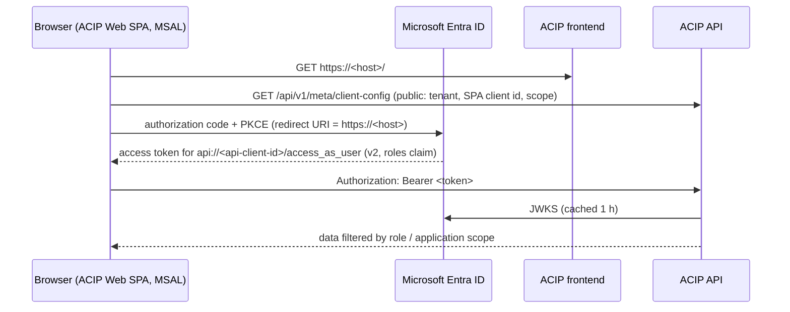

# Authentication and authorisation

ACIP uses **two separate identities**:

| Identity | Who | Purpose |
|---|---|---|
| Collection service principal (existing) | backend API + worker | Read Azure Cost Management, export storage, (optionally) Advisor / Activity Log. See `docs/azure-integration.md`. |
| Application users | people using the dashboard | Sign in with Microsoft Entra ID; the SPA calls the ACIP API with a delegated access token. |

The collection identity is never exposed to users, and user tokens are never used to call Azure.

## Modes (`APP_AUTH_MODE`)

- `disabled` — **local development only**. Every request runs as *Local Developer* with the
  administrator role. For testing RBAC, the header `X-ACIP-Dev-Role: viewer|engineering_lead|finops_analyst|administrator`
  downgrades the role, and `X-ACIP-Dev-Application: <application id>` restricts the user to one
  application's subscriptions. The UI exposes the role switch in the user menu (stored in
  `localStorage`, key `acip.devRole`). Never use this mode outside a developer machine.
- `entra` — staging / production.

## Entra configuration (step by step)

### Overview



| Registration | Type | Purpose | Secret |
|---|---|---|---|
| **ACIP API** | Expose an API + app roles | Audience of user access tokens; carries the app roles | none |
| **ACIP Web** | Single-page application | Signs users in (MSAL, auth code + PKCE) | none |
| Collection service principal | existing | Reads Azure cost data (`AZURE_*`), never used for user sign-in | client secret locally / Workload Identity in AKS |

Use **separate** registrations per environment (e.g. "ACIP API (staging)", "ACIP Web (staging)")
and keep them separate from the collection service principal. One registration *can* technically
act as API and SPA at once (the API then accepts `aud = <client id>`), but do not reuse the
collection service principal for user sign-in: it mixes the user-facing and the cost-reading
identity and its client secret.

### Values per environment

| Setting | Staging | Local (`.env`) |
|---|---|---|
| Host / redirect URI | `https://attcc-acip.stage.att.com` | `http://localhost:3000` |
| Tenant | `e741d71c-c6b6-47b0-803c-0f3b32b07556` | same |
| `APP_AUTH_MODE` | `entra` | `disabled` (or `entra` to test sign-in) |

### 1. ACIP API registration

Entra admin center → **App registrations** → **New registration**

1. Name `ACIP API (staging)`, *Accounts in this organizational directory only*, no redirect URI.
2. **Expose an API** → Application ID URI → `api://<api-client-id>` → **Add a scope**:
   - Scope name `access_as_user`, *Admins and users* can consent
   - Admin consent display name "Access ACIP as the signed-in user", state *Enabled*
3. **Manifest** (Microsoft Graph format): set v2 access tokens and add the app roles. The API rejects
   v1 tokens (issuer `sts.windows.net`), so `requestedAccessTokenVersion: 2` is mandatory.

   ```json
   "api": { "requestedAccessTokenVersion": 2, ... },
   "appRoles": [
     { "allowedMemberTypes": ["User"], "description": "Full access including subscriptions, connections, ingestion and settings.",
       "displayName": "ACIP Administrator", "id": "3f6b2c1e-8d4a-4e7b-9a52-6c1d0e7f8a91", "isEnabled": true, "value": "ACIP.Administrator" },
     { "allowedMemberTypes": ["User"], "description": "All reports; manage budgets, anomalies, savings and alert rules.",
       "displayName": "ACIP FinOps Analyst", "id": "7a9d4e2b-1c3f-4b8e-a6d5-2e9f0c1b7d34", "isEnabled": true, "value": "ACIP.FinOpsAnalyst" },
     { "allowedMemberTypes": ["User"], "description": "All reports; update anomaly and savings investigation status.",
       "displayName": "ACIP Engineering Lead", "id": "c2e8f5a1-6b4d-4a9c-8e37-5d1a9b0c3f62", "isEnabled": true, "value": "ACIP.EngineeringLead" },
     { "allowedMemberTypes": ["User"], "description": "Read-only access to reports.",
       "displayName": "ACIP Viewer", "id": "9b1c7d3e-2f5a-4c6b-b8e1-0a4d6f2e9c57", "isEnabled": true, "value": "ACIP.Viewer" }
   ]
   ```

   The `value`s must match exactly (they map to `roles.entra_app_role`); the `id`s only need to be
   unique GUIDs within the registration.

   | App role value | ACIP role | Permissions |
   |---|---|---|
   | `ACIP.Administrator` | `administrator` | read, export, manage_budgets, manage_anomalies, manage_savings, manage_alerts, admin, ingestion |
   | `ACIP.FinOpsAnalyst` | `finops_analyst` | read, export, manage_budgets, manage_anomalies, manage_savings, manage_alerts |
   | `ACIP.EngineeringLead` | `engineering_lead` | read, export, manage_anomalies, manage_savings |
   | `ACIP.Viewer` | `viewer` | read, export |

4. **Enterprise applications** → *ACIP API (staging)* → **Properties** → *Assignment required* = **Yes**.
5. **Users and groups** → **Add user/group** → pick users or groups and one app role each.
   Assigning groups requires Entra ID P1/P2.

### 2. ACIP Web registration (SPA)

1. **New registration** → name `ACIP Web (staging)`, single tenant.
2. **Authentication** → **Add a platform** → **Single-page application** → redirect URI
   `https://attcc-acip.stage.att.com` (exactly the origin, no trailing slash, no path; MSAL uses
   `window.location.origin` for sign-in and sign-out). Add `http://localhost:3000` only on a
   non-production registration. Leave implicit grant (access/ID tokens) **off**.
3. **API permissions** → **Add a permission** → *My APIs* → *ACIP API (staging)* → delegated
   `access_as_user` → **Grant admin consent**.
4. No client secret or certificate.

Optional: under *ACIP API (staging)* → **Expose an API** → **Add a client application**, pre-authorise
the ACIP Web client id for `access_as_user` (users then never see a consent prompt).

### 3. Configure ACIP

| Variable | Value |
|---|---|
| `APP_AUTH_MODE` | `entra` |
| `ENTRA_TENANT_ID` | tenant GUID |
| `ENTRA_API_CLIENT_ID` | ACIP API client id |
| `ENTRA_API_AUDIENCE` | optional; defaults to `api://<ENTRA_API_CLIENT_ID>` (the token `aud`) |
| `ENTRA_SPA_CLIENT_ID` | ACIP Web client id |
| `ENTRA_API_SCOPE` | `api://<api-client-id>/access_as_user` |

Helm (`values-staging.yaml` or your private override file):

```yaml
config:
  APP_AUTH_MODE: entra
  ENTRA_TENANT_ID: "e741d71c-c6b6-47b0-803c-0f3b32b07556"
  ENTRA_API_CLIENT_ID: "<acip-api-client-id>"
  ENTRA_API_AUDIENCE: ""
  ENTRA_SPA_CLIENT_ID: "<acip-web-client-id>"
  ENTRA_API_SCOPE: "api://<acip-api-client-id>/access_as_user"
```

None of these are secrets. The SPA reads them at runtime from `GET /api/v1/meta/client-config`
(public, no secrets), so the same frontend image is used in every environment. After changing them,
restart the backend (`kubectl -n acip rollout restart deploy/acip-backend`).

### 4. Verify

1. Open `https://attcc-acip.stage.att.com` → redirected to Microsoft sign-in → back to ACIP.
2. `GET /api/v1/meta/me` (browser dev tools, Network) shows your `roles` and `permissions`.
3. To inspect a token, copy the `Authorization` header value into https://jwt.ms and check:
   `aud` = `api://<api-client-id>` (or the client id), `iss` = `https://login.microsoftonline.com/<tenant>/v2.0`,
   `ver` = `2.0`, `scp` = `access_as_user`, `roles` contains an `ACIP.*` value.
4. Role changes appear after the user signs out and in again (new token).

### Troubleshooting

| Symptom | Cause / fix |
|---|---|
| `AADSTS50011` redirect URI mismatch | Register the exact origin (`https://attcc-acip.stage.att.com`) under the **SPA** platform. |
| `AADSTS9002326` cross-origin token redemption | Redirect URI was added under *Web* instead of *Single-page application*. |
| `AADSTS65001` consent required | Grant admin consent for `access_as_user` on ACIP Web, or pre-authorise the client. |
| `AADSTS50105` user not assigned | Assignment required = Yes and the user/group has no app role on ACIP API. |
| API 401 `Invalid issuer` | Token is v1: set `requestedAccessTokenVersion: 2` in the ACIP API manifest; sign in again. |
| API 401 `Invalid audience` | `ENTRA_API_AUDIENCE` / `ENTRA_API_CLIENT_ID` do not match the token `aud`. |
| API 401 `Token issued for a different tenant` | `ENTRA_TENANT_ID` differs from the token `tid`. |
| API 403 "no ACIP role" | No `roles` claim value and no database assignment: assign an app role, sign out/in. |
| "Unable to start ACIP: Configuration request failed" | Backend unreachable or `/api` ingress path missing. |

## Token validation (`app/security/auth.py`)

- RS256 signature against the tenant JWKS (`/<tenant>/discovery/v2.0/keys`, cached 1 h).
- `aud` ∈ {`ENTRA_API_AUDIENCE` or `api://<client id>`, `<client id>`}; `iss` = v2 issuer; `exp`,
  `iat` required; `tid` must equal the configured tenant.
- The user is upserted into `users` (Entra `oid`) on each request.
- Roles = token `roles` claim (mapped through `roles.entra_app_role`) ∪ database assignments.
- No role → HTTP 403 with guidance.

## Subscription-level authorisation

`POST /api/v1/admin/role-assignments` can grant a role scoped to one application
(`application_id`). A user whose grants are *all* application-scoped is restricted to the
subscriptions of those applications: every reporting query receives
`allowed_subscription_fks`, resource/anomaly detail endpoints return 404 outside the scope, and
filter options only list permitted subscriptions. Any unscoped grant (token app role or database
assignment without application) gives access to all subscriptions.

## Audit

State-changing endpoints write `audit_logs` (actor, action, entity, details, client IP):
subscription/application/mapping/rule/setting changes, role assignments, budget changes,
anomaly and savings status, ingestion triggers/retries/reprocess/backfill, connection tests.
Visible under Administration → Audit log (`GET /api/v1/admin/audit-logs`).
